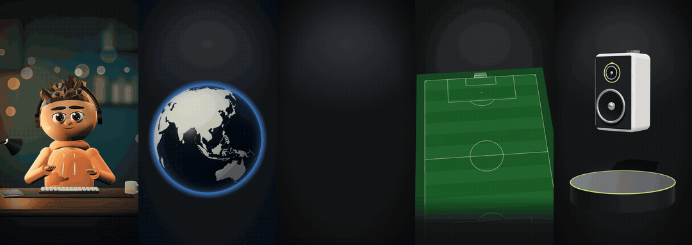
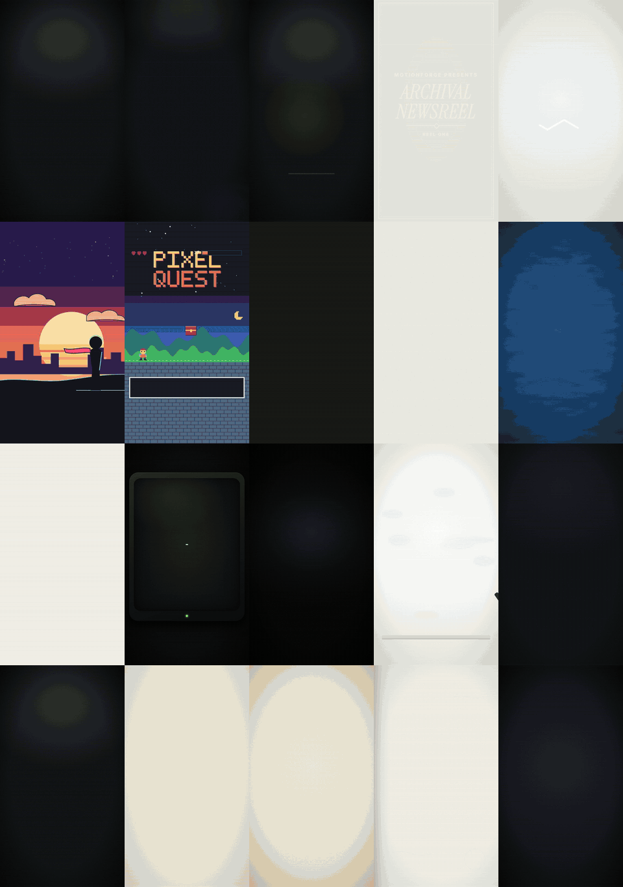
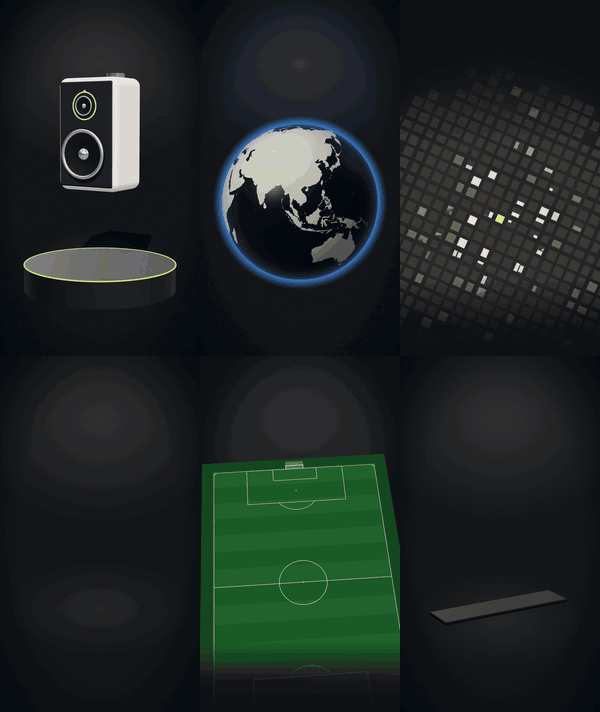

<div align="center">

# motionforge

**Motion design videos, written in code by your coding agent.**

Describe the video. Your agent writes the hook and script, times every word to the voice-over, builds 2D and 3D scenes, renders, and checks its own work before you see it.

[English](README.md) · [Türkçe](docs/i18n/README.tr.md) · [Español](docs/i18n/README.es.md) · [Português (BR)](docs/i18n/README.pt-BR.md) · [Français](docs/i18n/README.fr.md) · [Deutsch](docs/i18n/README.de.md) · [简体中文](docs/i18n/README.zh-CN.md) · [日本語](docs/i18n/README.ja.md) · [한국어](docs/i18n/README.ko.md) · [हिन्दी](docs/i18n/README.hi.md)

    



</div>

---

## Highlights

| | |
|---|---|
| **100 styles in 20 categories** | Creators, e-commerce, real estate, football, documentary, education, tech, finance, food, fitness, travel, events, news, business, gaming, kids, fashion, automotive, art direction and nonprofits. Each style is a full spec: palette, type, layout, motion, edit rhythm, sound and signature scenes. |
| **3D scenes with three.js** | Product turntables, a globe with flight arcs, a city with walking-distance rings, a house that builds itself, a football tactics pitch, 3D charts. Deterministic, frame-accurate, rendered offline. |
| **Talking characters and avatars** | A 3D presenter built from code, or your photo or illustration as a talking puppet. Mouths follow the voice-over. Free and local by default. Optional fal.ai, Wiro or local lip-sync models when you connect a key. |
| **Script to delivery** | Hooks and scripts with banned-phrase lists in 10 languages, word-level timing, captions, loudness, contact sheets and an independent critic before anything is delivered. |
| **Nothing paid without your yes** | Every paid call (voice, video, lip-sync) shows what it will generate and the estimated cost first, then waits. Keys come only from your environment. |

## How it works

You type something like:

> Make a 45-second reel for my real estate account about this flat. Map of the neighbourhood, 3D floor plan, my voice, captions.

motionforge turns that into a checked MP4 through fixed stages:

| Stage | What happens |
|---|---|
| **Brief** | The agent reads your request back in one sentence and asks only what is missing (format, length, language, voice). |
| **Hook & script** | 2–3 hook options, a script paced for speech, and a list of factual claims for you to verify. No invented statistics, no stock "AI phrases". |
| **Voice** | Your own recording, a local TTS model, or a paid TTS with your key after you approve the cost. |
| **Timing** | Word-level timestamps, so every title, logo and caption lands on the word that is spoken. |
| **Style & brand** | A style from the library plus your `brand.json` (colours, fonts, logo, watermark, outro). |
| **Scenes** | Seekable, deterministic code: HyperFrames (HTML + GSAP, with three.js for 3D) by default, Remotion or a canvas engine when they fit better. |
| **QA** | Contact sheets, text overflow and safe-area checks, reading time, loudness, lip-sync offset, and a fresh-context critic that never saw the build. |
| **Delivery** | MP4 in 9:16 / 1:1 / 16:9, a cover still, captions and a post description. Revisions by timestamp: "change the title at 0:12". |

## Style library

<p align="center"></p>

100 looks, grouped by the kind of account that uses them. A few per category:

| Category | Styles (examples) |
|---|---|
| Creators & personal brands | `creator-reels-dark`, `talking-head-pop`, `podcast-clip-studio`, `vlog-film-diary`, `cinematic-quote` |
| E-commerce & products | `product-hero-turntable`, `flash-sale`, `unboxing-pop`, `ugc-testimonial`, `before-after-split` |
| Real estate & maps | `map-flyover-pins`, `floorplan-draw-on`, `neighborhood-guide`, `listing-tour-cards`, `luxury-estate` |
| Football & sports | `matchday-graphics`, `tactics-board`, `player-stat-card`, `transfer-breaking`, `telestrator-replay` |
| Documentary & storytelling | `archival-newsreel`, `true-crime-board`, `history-map-campaign`, `interview-doc`, `cosmos-scale` |
| Education, tech, finance, news, food, travel, events, fashion… | see the full catalogue |

Full catalogue with one line per style: [skills/style-library/styles/README.md](skills/style-library/styles/README.md).

## 3D scenes

<p align="center"></p>

A three.js layer for the HyperFrames engine. The 3D canvas sits under the HTML text, each frame is computed from time alone (no clock, no random), and everything renders offline in headless Chrome. Bring your own GLB model or use the built-in procedural objects. Details: [engines/hyperframes/three](engines/hyperframes/three/README.md).

| Template | Use it for |
|---|---|
| `product-turntable-3d` | product launches, spec callouts on a lit pedestal |
| `globe-arcs-3d` | travel routes, global teams, history and news |
| `city-pin-3d` | property location, amenities and walking times |
| `house-build-3d` | listings, renovations, floor areas per room |
| `pitch-tactics-3d` | football analysis: runs, passes, pressing zones |
| `bars-3d` | growth and comparisons, with the source on screen |

## Faceless and UGC videos

<p align="center"></p>

For creators who don't want to be on camera and brands making UGC-style ads. The [`faceless-ugc`](skills/faceless-ugc/SKILL.md) skill offers four routes:

| Route | What you get | Cost |
|---|---|---|
| **No face** | kinetic captions, b-roll, screen recordings, hands-only or product-only formats | free |
| **3D character** | `character-3d`: a presenter built from code with five presets (creator, teacher, chef, coach, analyst), blinks, gestures and expressions on cues | free |
| **Photo avatar** | `photo-avatar`: your photo or illustration as a 2.5D puppet: jaw, inner mouth, head sway, breathing, blinks | free |
| **AI avatar** | image-to-video and lip-sync through fal.ai, Wiro or a lip-sync model on your own GPU (`tools/avatar`) | paid, behind a dry-run estimate and your approval |

Mouth movement comes from the voice-over (`tools/mouth_curve.py`), and every route ends with a lip-sync offset check (`tools/avatar/sync_check.py`). Avatars of real people need that person's consent, and AI presenters in ads are disclosed.

## Install

### Claude Code (plugin)

```text
/plugin marketplace add aykutucesai/motionforge
/plugin install motionforge@motionforge
```

Then ask for a video. The `motion-director` skill takes over.

### Codex, Cursor and other agents

```bash
git clone https://github.com/aykutucesai/motionforge
```

Point the agent at [`AGENTS.md`](AGENTS.md). Every skill is plain Markdown with exact commands, so any agent that can read files and run a shell can follow it.

### Requirements

- Node.js 18+ (22 recommended) and ffmpeg
- Python 3.10+ with numpy
- Optional: `faster-whisper` (word timings), `rembg` (cut-outs), `fonttools` (glyph checks), `mediapipe` (face landmarks), `fal-client` (fal.ai), Playwright Chromium

The agent checks these at the start of a job and tells you exactly what to install.

## Try these prompts

```text
Turn this voice-over (voice.mp3) into a 9:16 reel. Kinetic captions, dark style, real logos for every product I mention.
```
```text
Make a 30-second product video for this speaker with a 3D turntable and three spec callouts. Use my brand kit.
```
```text
Explain this counter-attack on a 3D pitch: three passes, one run, then the goal. Matchday style.
```
```text
I don't want to show my face. Make a 3D presenter with glasses and a green hoodie who reads this script.
```
```text
Write 3 hook options and a 70-second script in Spanish about saving money on software. Don't generate audio yet.
```

## What's inside

```
motionforge/
├─ AGENTS.md                 entry point for any agent
├─ skills/
│  ├─ motion-director/       the full workflow and its approval gates
│  ├─ script-and-hooks/      hooks, scripts, claim list, banned phrases (10 languages)
│  ├─ voice-and-timing/      consent-gated TTS, word timings, captions, loudness
│  ├─ style-library/         100 styles in 20 categories, one STYLE.md each
│  ├─ brand-kit/             brand.json: colours, fonts, logos, watermark, outro
│  ├─ faceless-ugc/          no-face formats, characters, avatars, lip-sync, UGC ad formats
│  └─ qa-review/             checks + independent critic
├─ engines/
│  ├─ hyperframes/           default engine (HTML + GSAP, Apache-2.0)
│  │  └─ three/              3D layer: stage, lights, orbit, labels that follow 3D points
│  ├─ remotion/              optional React engine + kit
│  └─ canvas/                frame = f(t) pages for hand-drawn and procedural looks
├─ templates/                16 ready scenes: 8 in 2D, 6 in 3D, character-3d, photo-avatar
├─ examples/styles/          the scenes behind the style previews
└─ tools/                    word timings, mouth curve, avatar CLI, sync check, cut-out,
                             loudness, contact sheet, text check, export, cover safe area
```

Every template animated: [templates/README.md](templates/README.md).

## Principles

1. **Free by default.** The default engine, HyperFrames, is Apache-2.0; three.js is MIT. Remotion and paid APIs are optional (see [Licensing](docs/LICENSING.md)).
2. **Deterministic.** Every frame is a function of time. Same input, same video.
3. **Nothing paid without consent.** The agent names the cost first and waits.
4. **Honest content.** Claims that need a source are listed for you; mock screens, example data and AI presenters are disclosed.
5. **Checked before delivery.** If QA has an open failure, the video is not delivered.

## Languages

Skill instructions are written in English for agents. The agent talks to you in your language and writes scripts, captions and on-screen text in the video's language. Hook patterns and banned-phrase lists are native in:

English · Türkçe · Español · Português (Brasil) · Français · Deutsch · 简体中文 · 日本語 · 한국어 · हिन्दी

## Licensing

motionforge is released under the [MIT License](LICENSE). It calls third-party tools that keep their own licences; see [THIRD_PARTY.md](THIRD_PARTY.md) and the plain-language guide in [docs/LICENSING.md](docs/LICENSING.md). In short: HyperFrames is Apache-2.0; three.js is MIT; GSAP is installed from npm under its own licence; Remotion is free for individuals and companies with up to 3 employees and needs a company licence above that. Map data comes from Natural Earth (public domain) and OpenStreetMap (ODbL, credit required).

## Contributing

Issues and pull requests are welcome: new styles, templates, 3D scenes, language lists, engine improvements. Read [CONTRIBUTING.md](CONTRIBUTING.md) first.

---

<div align="center">

Made by <a href="https://www.instagram.com/aykutucesai/">Aykut Üçeş</a> · <a href="https://x.com/Aykutuces">@Aykutuces</a>

</div>
