# Style catalogue

100 styles in 20 categories, each a `STYLE.md` in the same format (`_template/STYLE.md`).
How to pick, customise or create one: [`../SKILL.md`](../SKILL.md). All styles are original
motionforge work (MIT); fonts named in them are free (SIL OFL or similar) but are not bundled.

## Gallery (first 20 styles)

Four-second previews rendered from [`examples/styles/`](../../../examples/styles/) with the HyperFrames engine.

<table>
  <tr>
    <td align="center" valign="top" width="25%"><a href="creator-reels-dark/STYLE.md">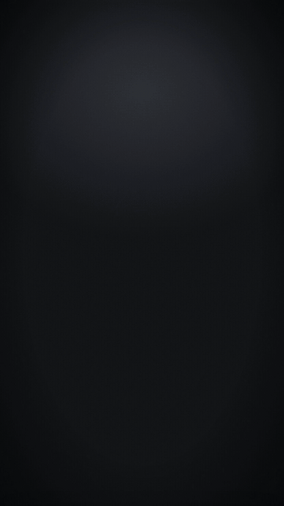</a> <code>creator-reels-dark</code> Charcoal + lime accent, bold sans with an italic-serif word, pop-out talking head in a rounded card</td>
    <td align="center" valign="top" width="25%"><a href="agency-info-brand/STYLE.md">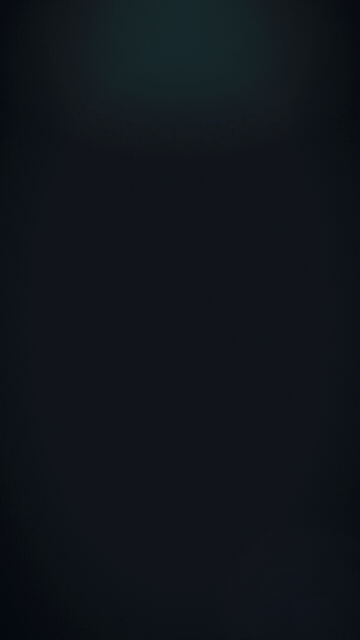</a> <code>agency-info-brand</code> Brand-kit colours on dark, corner watermark, captions, save/send CTA, logo end card</td>
    <td align="center" valign="top" width="25%"><a href="kinetic-captions/STYLE.md">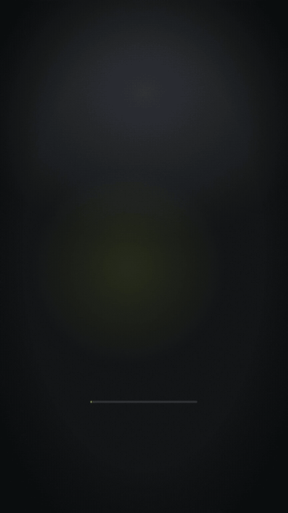</a> <code>kinetic-captions</code> Big voice-synced words on a quiet field, accent on the stressed word</td>
    <td align="center" valign="top" width="25%"><a href="archival-newsreel/STYLE.md">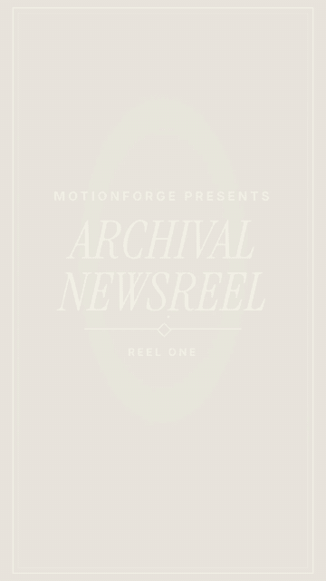</a> <code>archival-newsreel</code> Black-and-white film, gate weave and dust, slab-serif title cards</td>
  </tr>
  <tr>
    <td align="center" valign="top" width="25%"><a href="storybook-isometric/STYLE.md">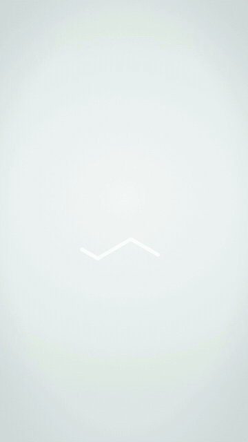</a> <code>storybook-isometric</code> Pastel isometric miniatures that assemble block by block</td>
    <td align="center" valign="top" width="25%"><a href="retro-anime-cel/STYLE.md">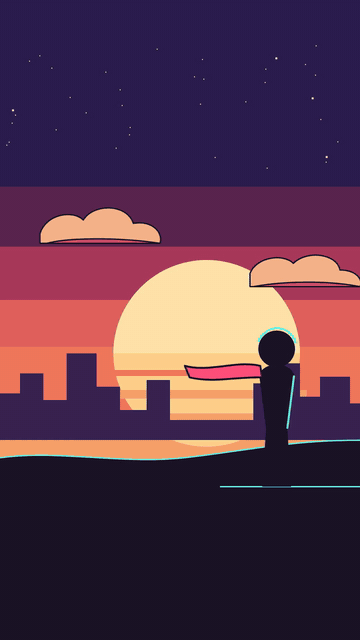</a> <code>retro-anime-cel</code> Two-tone cel shading, glowing highlights, speed lines, sunset skies</td>
    <td align="center" valign="top" width="25%"><a href="pixel-quest/STYLE.md">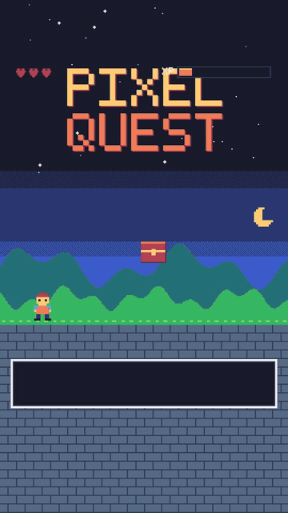</a> <code>pixel-quest</code> 16-bit sprites, tile levels, dialogue boxes, level-up chimes</td>
    <td align="center" valign="top" width="25%"><a href="rubber-hose-toon/STYLE.md">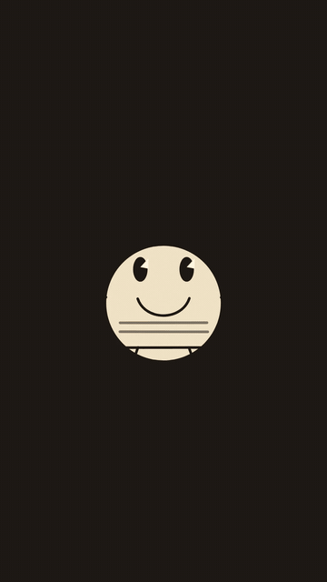</a> <code>rubber-hose-toon</code> Early-cartoon bendy limbs, sepia ink on cream, everything on the beat</td>
  </tr>
  <tr>
    <td align="center" valign="top" width="25%"> <code>riso-print</code> Two spot inks overprinting, halftones, slight misregistration</td>
    <td align="center" valign="top" width="25%"><a href="blueprint-schematic/STYLE.md">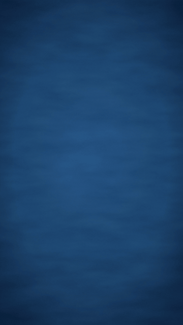</a> <code>blueprint-schematic</code> White line work on cyanotype blue, exploded views, callouts (no grid)</td>
    <td align="center" valign="top" width="25%"> <code>swiss-poster</code> Strict columns, huge grotesque type, flat red blocks</td>
    <td align="center" valign="top" width="25%"><a href="terminal-crt/STYLE.md">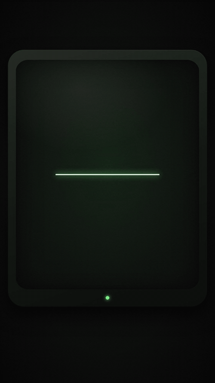</a> <code>terminal-crt</code> Phosphor monospace on a tube, typing commands, scanlines and bloom</td>
  </tr>
  <tr>
    <td align="center" valign="top" width="25%"><a href="keynote-dark/STYLE.md">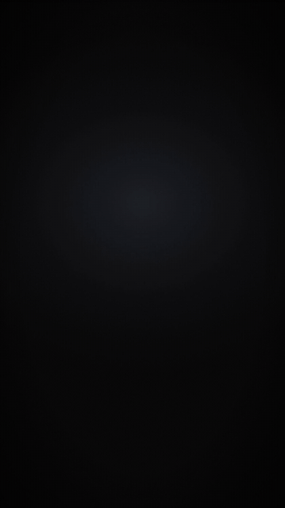</a> <code>keynote-dark</code> Near-black stage, one lit hero object, gradient word, big numbers</td>
    <td align="center" valign="top" width="25%"><a href="marker-whiteboard/STYLE.md">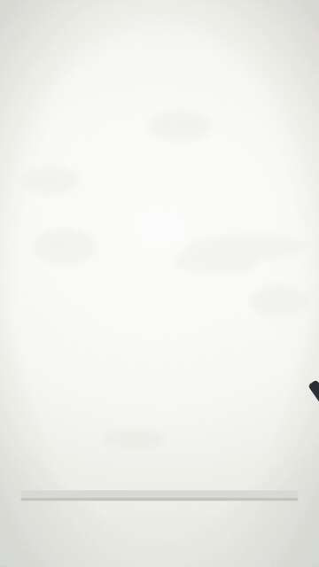</a> <code>marker-whiteboard</code> Marker sketches drawn live on a clean board, arrows and circles</td>
    <td align="center" valign="top" width="25%"> <code>data-story</code> Honest charts, grey first, one accent insight, visible source</td>
    <td align="center" valign="top" width="25%"><a href="screencast-zoom/STYLE.md">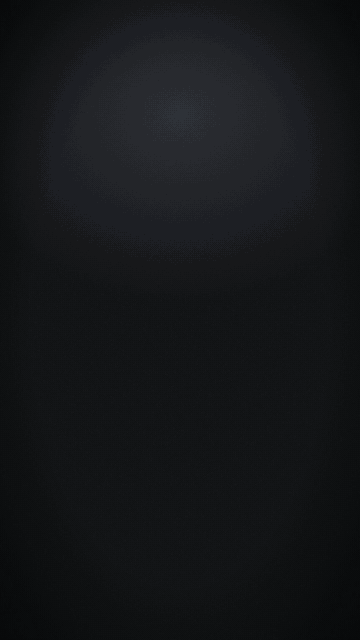</a> <code>screencast-zoom</code> Real screens in a floating window, guided zooms and highlights</td>
  </tr>
  <tr>
    <td align="center" valign="top" width="25%"> <code>paper-cutout</code> Layered coloured card with real shadows, stop-motion jitter</td>
    <td align="center" valign="top" width="25%"><a href="ink-crosshatch/STYLE.md">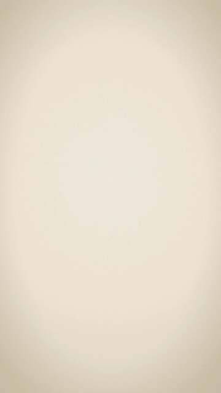</a> <code>ink-crosshatch</code> Pen-and-ink hatching on warm paper with one colour wash</td>
    <td align="center" valign="top" width="25%"><a href="sketchbook-pencil/STYLE.md">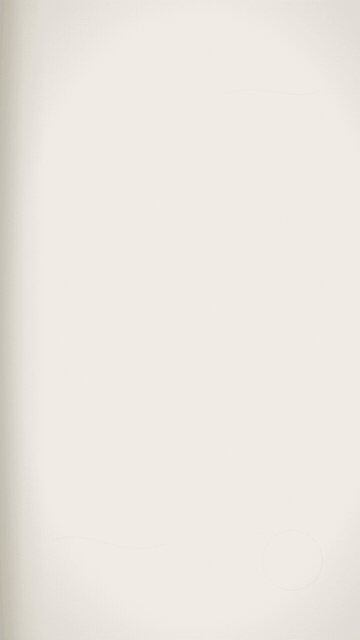</a> <code>sketchbook-pencil</code> Graphite sketches, sticky notes and taped photos on a sketchbook page</td>
    <td align="center" valign="top" width="25%"><a href="math-explainer/STYLE.md">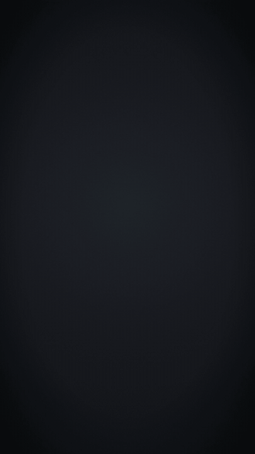</a> <code>math-explainer</code> Colour-coded geometry and equations morphing on dark slate</td>
  </tr>
</table>

**Categories:** [Creators & personal brands](#creators--personal-brands) · [E-commerce & products](#e-commerce--products) · [Real estate & maps](#real-estate--maps) · [Football & sports](#football--sports) · [Documentary & storytelling](#documentary--storytelling) · [Education & explainers](#education--explainers) · [Tech, SaaS & AI](#tech-saas--ai) · [Finance & money](#finance--money) · [Food & restaurants](#food--restaurants) · [Fitness, health & wellness](#fitness-health--wellness) · [Travel & hospitality](#travel--hospitality) · [Music, events & weddings](#music-events--weddings) · [News & commentary](#news--commentary) · [Business, B2B & local](#business-b2b--local) · [Gaming & esports](#gaming--esports) · [Kids & animation](#kids--animation) · [Fashion & beauty](#fashion--beauty) · [Automotive](#automotive) · [Art direction & design looks](#art-direction--design-looks) · [Nonprofit & causes](#nonprofit--causes)

## Creators & personal brands

| Style | Look | Best for | Engine |
|---|---|---|---|
| [creator-reels-dark](creator-reels-dark/STYLE.md) | Charcoal stage, one lime accent, a bold sans headline with a single italic-serif word, and the presenter's head breaking out… | talking-head explainers about tools, AI, software, creator tips | remotion (edit) + hyperframes (scenes) |
| [kinetic-captions](kinetic-captions/STYLE.md) | The words are the picture: big, voice-synced type that lands word by word on a quiet field, with one accent colour marking the… | voice-led shorts without footage, quotes, hot takes, story hooks | hyperframes (or canvas) |
| [vlog-film-diary](vlog-film-diary/STYLE.md) | A day told in warm, slightly faded footage: an orange LED date stamp in the corner, handwritten time-of-day notes, and moments… | daily vlogs, travel days, "a day in my life", weekly recaps | remotion (edit) + hyperframes (overlays) |
| [podcast-clip-studio](podcast-clip-studio/STYLE.md) | A vertical cut of a long conversation: the speaker in a framed window, a coral ring on whoever is talking, a waveform bar with… | podcast and interview clips, panel highlights, live-stream cut-downs | remotion (edit) + hyperframes (graphics) |
| [talking-head-pop](talking-head-pop/STYLE.md) | Full-frame phone footage of one person talking, a punch-in on every cut, chunky captions on white plates with the key word on… | opinion and advice shorts, coaching tips, story-time, reactions | remotion (edit) + hyperframes (cards) |
| [minimal-journal](minimal-journal/STYLE.md) | A beige page, thin serif lines appearing one at a time, small mounted photographs and long dissolves — like reading someone's… | calm personal stories, reflections, letters, year-in-review, slow essays | hyperframes |
| [cinematic-quote](cinematic-quote/STYLE.md) | Footage inside a widescreen band between black bars, a slow push, a large serif quote set in the lower bar line by line, and a… | quotes, mottos, short reflections, book lines, motivational openers | hyperframes (remotion for long footage) |

## E-commerce & products

| Style | Look | Best for | Engine |
|---|---|---|---|
| [product-hero-turntable](product-hero-turntable/STYLE.md) | One product turning slowly on a white plinth in a cool-grey studio cove, soft contact shadow, thin leader lines snapping to… | product launches, feature tours, spec explainers, store listings | hyperframes + three.js |
| [unboxing-pop](unboxing-pop/STYLE.md) | Top-down on kraft cardboard: flaps fold open one after another, items rise out with a squash, and die-cut pink stickers slap… | unboxings, subscription boxes, order reveals, "what's in the kit" | hyperframes (+ three.js for the box) |
| [flash-sale](flash-sale/STYLE.md) | Saturated red field, yellow starburst cards, condensed numbers the height of the screen, an old price slashed on the beat and… | time-limited sales, discount codes, seasonal promos, launch-day offers | hyperframes |
| [ugc-testimonial](ugc-testimonial/STYLE.md) | Real customers' phone clips framed as rounded review cards: their first name and city, the stars they actually gave, and the… | customer reviews, social proof ads, service testimonials, app reviews | remotion (edit) + hyperframes (cards) |
| [catalog-grid](catalog-grid/STYLE.md) | A gallery wall of white product tiles on a warm-grey field; the camera glides across it, dives into one tile until it fills… | collection launches, shop tours, "5 picks under X", new arrivals, gift guides | hyperframes |
| [before-after-split](before-after-split/STYLE.md) | One frame divided by a slider: "before" on the left under a grey tag, "after" on the right under a mint tag, a round handle… | renovations, cleaning, detailing, design makeovers, photo edits, product results | hyperframes (remotion for timelapse footage) |
| [luxury-product](luxury-product/STYLE.md) | A product rising out of black into a warm pool of light, a narrow gold light sweep gliding across its surface, a high-contrast… | jewellery, watches, fragrance, leather goods, fine spirits, premium launches | hyperframes + three.js (remotion for macro footage) |
| [beauty-glow](beauty-glow/STYLE.md) | A soft blush field, a glossy specular highlight gliding across bottles and skin close-ups, falling droplets that ripple, and… | skincare and cosmetics, routines, ingredient explainers, salon services | hyperframes (remotion for routine footage) |

## Real estate & maps

| Style | Look | Best for | Engine |
|---|---|---|---|
| [map-flyover-pins](map-flyover-pins/STYLE.md) | A dark, desaturated street map tilts and glides between places: a coral route line draws itself, pins drop with a bounce and… | property location, "how far is it from…", commutes, branch openings, short itineraries | hyperframes (SVG or vector-tile map); hyperframes + three.js for the 3D arrival |
| [floorplan-draw-on](floorplan-draw-on/STYLE.md) | An architect's presentation plan on warm drafting vellum: walls trace and fill solid graphite, door swings arc open, and rooms… | layouts of flats and houses, off-plan sales, renovation before/after, furniture fit | hyperframes (layered SVG); hyperframes + three.js for plan-to-volume |
| [listing-tour-cards](listing-tour-cards/STYLE.md) | Bright daylight walkthrough footage with slow pans, and crisp white fact cards with a teal edge tab that slide up for price,… | sale and rental listings, agent reels, open-house invites | hyperframes (cards) + remotion (optional, footage-heavy edits) |
| [neighborhood-guide](neighborhood-guide/STYLE.md) | A friendly daylight street map centred on one home: walking-time rings breathe outward and amenity badges pop in category by… | area guides, relocation, "what's within 10 minutes", local business area promos | hyperframes (SVG map); hyperframes + three.js for the tilted intro |
| [luxury-estate](luxury-estate/STYLE.md) | Slow drone and gimbal moves through a high-end home, thin spaced-capital serif titles, a champagne hairline frame and long… | premium listings, architect-designed homes, villas and hotels for sale, developer launch films | remotion (footage edit) + hyperframes (titles) |
| [market-stats](market-stats/STYLE.md) | A crisp property research note on cool paper: price-per-m² columns rise, districts line up as sorted bars, and one raspberry… | housing market updates, rent vs buy, district comparisons, agency market reports | hyperframes (SVG charts); hyperframes + three.js for one hero chart |

## Football & sports

| Style | Look | Best for | Engine |
|---|---|---|---|
| [matchday-graphics](matchday-graphics/STYLE.md) | A night-match broadcast package: navy field under floodlight haze, slanted score panels in the two kit colours, lineups that… | match previews, lineups, live-score and full-time posts for clubs, fan and sports-media accounts | hyperframes (graphics) + remotion (optional, footage-heavy edits) |
| [tactics-board](tactics-board/STYLE.md) | A tilted matte-green pitch where flat player tokens shift into shape, pass arrows draw ball by ball, and cyan pressing zones… | tactical analysis, coaching sessions, formation explainers, "how this goal was built" | hyperframes (SVG board) or hyperframes + three.js (tilted pitch) |
| [player-stat-card](player-stat-card/STYLE.md) | A tall collectible card with a cut-out player breaking its top edge, a silver foil border that catches one moving light, a… | player profiles, scouting summaries, season reviews, head-to-heads, academy player cards | hyperframes + three.js (card tilt) or hyperframes (flat) |
| [transfer-breaking](transfer-breaking/STYLE.md) | A hard red breaking bar tears across the frame, the screen splits diagonally into two club-colour fields, a fee odometer rolls… | transfer news, contract renewals, signing announcements, rumour round-ups for sports media and fan accounts | hyperframes |
| [telestrator-replay](telestrator-replay/STYLE.md) | Real match footage slows and freezes, everything dims except one player, and bright yellow pen strokes are drawn over the play… | analysis on real footage, refereeing decisions, coaching feedback on amateur and academy video | hyperframes (overlays) + remotion (optional, footage-heavy edits) |
| [fixture-countdown](fixture-countdown/STYLE.md) | A printed matchday-programme feel on warm paper: split-flap tiles clatter to the next opponent and date, a giant days-to-go… | next-match posts, season and month schedules, tournament group stages, ticket reminders, local league updates | hyperframes |
| [athlete-hype-reel](athlete-hype-reel/STYLE.md) | Fast highlights of one athlete: on the decisive frame the action freezes, the frame turns to a crushed-black duotone, the… | individual highlight reels, recruiting and scouting tapes, signing posts, season recaps, any sport | remotion (footage cut) + hyperframes (slams and chips) |

## Documentary & storytelling

| Style | Look | Best for | Engine |
|---|---|---|---|
| [archival-newsreel](archival-newsreel/STYLE.md) | Black-and-white film stock, gate weave and dust, bold slab-serif title cards, and an announcer's cadence — history told like a… | "how it started", anniversaries, history of a technology or company | canvas (film effects) + hyperframes (title cards) |
| [true-crime-board](true-crime-board/STYLE.md) | A dim corkboard under one desk lamp: case photos pinned at slight angles, red string pulled between them, typewritten dates,… | case recaps, fraud and scam stories, historical mysteries, court-case explainers | hyperframes |
| [nature-field-notes](nature-field-notes/STYLE.md) | A naturalist's notebook: an ink sketch of the animal draws itself and real footage fades in beneath until they match, with… | wildlife and plant profiles, ecology, trails and parks, citizen science | canvas (sketch strokes) + hyperframes (plates, labels) |
| [history-map-campaign](history-map-campaign/STYLE.md) | An engraved map on aged paper where two inks advance and retreat: tapered arrows sweep along routes, borders redraw, and a… | campaigns and battles, empires, migrations, border changes, trade routes | hyperframes (SVG map) + three.js for globe openers |
| [interview-doc](interview-doc/STYLE.md) | Quiet documentary interview: a person framed off-centre, name supers that slide out from behind a thin amber rule, slow pushes… | founder stories, oral histories, expert interviews, customer stories, mini-docs | remotion (footage edit) + hyperframes (supers, chapter cards) |
| [timeline-chronicle](timeline-chronicle/STYLE.md) | A museum wall painted deep green: one horizontal line runs through the frame, big serif years roll past like an odometer, and… | company and product histories, biographies, "how X changed", anniversaries | hyperframes |
| [cosmos-scale](cosmos-scale/STYLE.md) | Black space with honest proportions: planets and stars at true relative size, a camera that pulls back one order of magnitude… | astronomy, space missions, "how big is…", distance and light-time explainers | hyperframes + three.js (canvas starfield) |

## Education & explainers

| Style | Look | Best for | Engine |
|---|---|---|---|
| [math-explainer](math-explainer/STYLE.md) | Clean geometry and equations on a dark slate: shapes transform into each other, terms of an equation move to where they… | maths, physics, algorithms, ML concepts, any "why does this work" | canvas (or hyperframes with SVG + KaTeX) |
| [marker-whiteboard](marker-whiteboard/STYLE.md) | Hand-drawn marker sketches appearing on a clean board: simple icons, arrows and boxed words that build an idea step by step,… | concepts, frameworks, processes, education | hyperframes (SVG stroke draw) or canvas |
| [blueprint-schematic](blueprint-schematic/STYLE.md) | White technical line work on deep cyanotype blue: parts drawn stroke by stroke, dimension lines, callouts and exploded views —… | how-it-works, engineering, architecture, product anatomy | hyperframes (SVG stroke drawing) or canvas |
| [storybook-isometric](storybook-isometric/STYLE.md) | Small, tidy isometric worlds in soft pastel paint — tiny houses, roads and machines that assemble themselves while a calm… | systems, processes, cities, supply chains, "how the internet works" | canvas or hyperframes (CSS 3D / three.js orthographic) |
| [science-lab](science-lab/STYLE.md) | A bright lab bench: clean labelled glassware, ball-and-stick molecules turning in 3D beside it, a reagent that changes colour… | chemistry, biology and physics demos, "what happens when…", school and university science | hyperframes + three.js |
| [language-flashcards](language-flashcards/STYLE.md) | Cream cards on a deep teal desk: a word flips to show its meaning and IPA, the stressed syllable jumps on its beat, and an… | vocabulary, pronunciation drills, phrase packs, false friends, short grammar points | hyperframes |
| [quiz-countdown](quiz-countdown/STYLE.md) | Game-show cobalt: a big question, four white answer tiles, a yellow 3-2-1 ring that drains exactly on the second, and a reveal… | trivia, test-yourself series, exam and licence-test practice, recap quizzes | hyperframes |
| [chalkboard-lesson](chalkboard-lesson/STYLE.md) | A worn green classroom board in a wooden frame: chalk handwriting writes itself with a little dust, yellow chalk underlines… | school lessons, grammar rules, worked examples, mnemonics, teacher accounts | canvas |

## Tech, SaaS & AI

| Style | Look | Best for | Engine |
|---|---|---|---|
| [screencast-zoom](screencast-zoom/STYLE.md) | Real screens, framed and directed: a browser or app window floats on a soft backdrop, the camera glides and zooms to each… | product demos, tutorials, repo/site walkthroughs, "how I did X" | hyperframes (or remotion) |
| [terminal-crt](terminal-crt/STYLE.md) | A glowing phosphor terminal on a curved tube: monospaced text typing out, a blinking block cursor, scanlines and a faint bloom… | developer tools, AI agents, hacking/security explainers, CLI walkthroughs | hyperframes (or canvas for the tube effect) |
| [keynote-dark](keynote-dark/STYLE.md) | A product-launch stage: near-black space, one luminous object, a gradient-lit headline word and big confident numbers revealed… | launches, feature reveals, before/after numbers, annual recaps | hyperframes (CSS 3D / three.js) |
| [saas-launch-glass](saas-launch-glass/STYLE.md) | Frosted glass panes float over a blurred capture of the real product; feature chips snap onto the glass one per beat, and a… | SaaS launches, feature drops, changelog videos, pricing updates | hyperframes + three.js (device shots) |
| [ai-agent-flow](ai-agent-flow/STYLE.md) | A clean ink diagram on pale sage paper: agents as rounded nodes, tools as square chips, and violet pulses travelling along the… | agent architectures, automations, tool-calling explainers, workflow builds | hyperframes (SVG) or canvas |
| [code-diff](code-diff/STYLE.md) | A dark code editor where removed lines tint red and collapse, added lines open and type in green, and highlighter-yellow… | code reviews, refactors, bug-fix stories, "what changed in this PR", AI-written code | hyperframes |

## Finance & money

| Style | Look | Best for | Engine |
|---|---|---|---|
| [data-story](data-story/STYLE.md) | Clean, honest charts that animate one insight at a time: bars grow, lines draw, the key point lights up in the accent and gets… | statistics, trends, comparisons, research summaries | hyperframes (SVG/HTML charts) |
| [market-terminal](market-terminal/STYLE.md) | A dense, sober trading-desk screen: monospaced prices, a scrolling ticker tape, candlesticks that build bar by bar, cells that… | market recaps, earnings, macro news, stock and index explainers | hyperframes + three.js (globe scene only) |
| [crypto-neon-chart](crypto-neon-chart/STYLE.md) | One glowing aqua price line racing across a black field, glossy coin and wallet cards that flip into view, and transfers… | crypto and token explainers, on-chain stories, wallet how-tos, volatility recaps | hyperframes + three.js (coin and wallet renders) |
| [budget-infographic](budget-infographic/STYLE.md) | Friendly pastel icons on warm cream, a donut that splits into spending categories, bars that compare months, and a green… | personal budgeting, saving plans, cost-of-living breakdowns, money tips | hyperframes (SVG) |
| [receipt-roll](receipt-roll/STYLE.md) | A thermal printer feeds a receipt line by line in step with the voice; prices align right, a dashed rule prints, the total… | price breakdowns, "what I spent", cost comparisons, hidden fees, shopping hauls | hyperframes (canvas for paper curl) |

## Food & restaurants

| Style | Look | Best for | Engine |
|---|---|---|---|
| [bistro-menu-cards](bistro-menu-cards/STYLE.md) | Cream menu cards placed one by one on real linen; dish photos slide out from under the paper, prices sit in a refined serif,… | restaurant and café menus, daily specials, tasting menus, opening announcements | hyperframes |
| [recipe-top-down](recipe-top-down/STYLE.md) | A locked overhead view of a slate worktop: ingredients get ticked off a checklist as they land in frame, numbered step cards… | recipes, meal prep, cooking how-tos, bakery and café "how we make it" | remotion (footage edit) + hyperframes (cards, timers) |
| [food-macro-warm](food-macro-warm/STYLE.md) | Extreme close-ups in warm light, shallow focus and rising steam, with one big italic appetite word tucked behind the food so… | restaurant and product ads, signature dishes, bakery drops, food brand teasers | remotion (footage-heavy edit) + hyperframes (type layers) |

## Fitness, health & wellness

| Style | Look | Best for | Engine |
|---|---|---|---|
| [gym-hype](gym-hype/STYLE.md) | Black gym floor, chalk-white condensed type the height of the frame, one blaze-orange rep counter, and hard cuts that land on… | training clips, PR attempts, coach tips, gym promos, challenge reels | hyperframes (graphics) + remotion (optional, footage-heavy edits) |
| [workout-intervals](workout-intervals/STYLE.md) | A follow-along session screen: a thick countdown ring that empties in real time, mint for work, amber for rest, and an… | follow-along HIIT/Tabata/EMOM sessions, circuit plans, home-workout guides | hyperframes |
| [wellness-sage](wellness-sage/STYLE.md) | Sand-coloured paper light, a sage circle that swells and settles at breathing pace, a soft optical serif, and fades so slow… | breathing exercises, yoga and mobility flows, sleep and stress routines, studio promos | hyperframes |
| [clinic-clean](clinic-clean/STYLE.md) | Bright clinical white, one calm blue, numbered icon steps and a highly legible sans — health information that reads like a… | clinic and practitioner explainers, symptom/prevention info, procedure steps, appointment guides | hyperframes |

## Travel & hospitality

| Style | Look | Best for | Engine |
|---|---|---|---|
| [passport-stamps](passport-stamps/STYLE.md) | Cream security-paper pages with fine wavy guilloche lines, rubber entry stamps thudding down in vermilion and green ink, and a… | multi-country trips, travel recaps, visa and entry tips, "countries I visited" lists | hyperframes (+ three.js for the globe beat) |
| [route-journey](route-journey/STYLE.md) | A muted OpenStreetMap base, one raspberry route line that draws itself leg by leg, transport icons riding the line, and day… | road trips, rail journeys, multi-day itineraries, walking and cycling routes, tour packages | hyperframes (+ three.js for 3D city stops) |
| [postcard-collage](postcard-collage/STYLE.md) | A kraft-paper desk where postcards, instant photos and ticket stubs are laid down by hand, held with washi tape, and annotated… | city guides, weekend trips, hotel and café recommendations, personal travel diaries | hyperframes |

## Music, events & weddings

| Style | Look | Best for | Engine |
|---|---|---|---|
| [lyric-kinetic](lyric-kinetic/STYLE.md) | Word-by-word lyrics on a deep wine field: each word lands on its syllable's beat, sung-long words stretch with the note, and… | lyric videos, single and album teasers, song-snippet reels, live-session captions | hyperframes |
| [gig-poster-grunge](gig-poster-grunge/STYLE.md) | A photocopied show flyer come to life: toner-black slab type, torn paper edges, a day-glo sticker strip, and the date stamped… | club nights, small-venue shows, band tours, open mics, DIY event promos | canvas (or hyperframes with blend modes) |
| [festival-lineup](festival-lineup/STYLE.md) | A midnight-blue festival bill that builds tier by tier — small names first, the headliner last and biggest in sun-yellow —… | festival line-up announcements, day splits, stage times, conference and fair programmes | hyperframes |
| [wedding-elegant](wedding-elegant/STYLE.md) | Ivory stationery in motion: a flowing script name pair, a classic high-contrast serif, fine botanical line art that grows… | save-the-dates, wedding films' titles and highlights, invitations, anniversaries, venue and planner promos | hyperframes |
| [ticket-stub-event](ticket-stub-event/STYLE.md) | The whole promo is one oversized paper ticket: fields for date, door, row and seat fill in like they are being printed, the… | single-date events: concerts, comedy nights, theatre, talks, screenings, sports nights at local venues | hyperframes (+ three.js for the venue pin) |

## News & commentary

| Style | Look | Best for | Engine |
|---|---|---|---|
| [breaking-ticker](breaking-ticker/STYLE.md) | A broadcast news package in 9:16: a red tag slams onto a white headline slab, a yellow ticker crawls at a steady pace below, a… | news updates, announcements, policy changes, results, event coverage | hyperframes (remotion for footage-heavy packages) |
| [newspaper-print](newspaper-print/STYLE.md) | A front page on grey-white newsprint: dense justified columns, a heavy serif headline the camera dives into, halftone photos,… | news analysis, press roundups, historic front pages, op-eds, explaining one article | hyperframes (canvas halftone pass) |
| [social-recap](social-recap/STYLE.md) | Real posts as white cards stacked on a cool grey field: each new card slides up and pushes the last one back, its counts tick… | reaction roundups, online debates, launch responses, weekly internet recaps | hyperframes |

## Business, B2B & local

| Style | Look | Best for | Engine |
|---|---|---|---|
| [annual-report](annual-report/STYLE.md) | A composed corporate layout on light stone: brand-colour blocks wipe across the frame, KPI tiles count up in tabular figures,… | year-in-review, investor and stakeholder updates, quarterly results, company milestones | hyperframes + three.js (columns and globe scenes) |
| [now-hiring](now-hiring/STYLE.md) | Bright butter-yellow field, role cards dealt like a hand of cards, real team faces and perks popping in as icons, and an… | job openings, recruitment campaigns, internship calls, employer-brand shorts | hyperframes + three.js (remote-team globe only) |
| [case-study](case-study/STYLE.md) | A three-act business story on warm stone: an editorial serif chapter card for Problem, Approach and Result, greyed "before"… | client case studies, project retrospectives, agency portfolios, B2B proof stories | hyperframes (remotion for interview-led edits) |
| [local-shop-promo](local-shop-promo/STYLE.md) | The real storefront in morning light, opening hours set letter by letter on a felt board, a pin dropping onto an OpenStreetMap… | shops, cafés, salons, workshops, clinics, new openings, local services | hyperframes + three.js (map scene); remotion for footage-heavy edits |

## Gaming & esports

| Style | Look | Best for | Engine |
|---|---|---|---|
| [pixel-quest](pixel-quest/STYLE.md) | A 16-bit adventure: chunky pixel sprites, tile-built levels, dialogue boxes and level-up chimes — explaining a journey as a game. | step-by-step journeys, "level up your skills", gaming and dev culture | canvas (pixel-exact) |
| [esports-hud](esports-hud/STYLE.md) | Broadcast-style match graphics: chamfered dark panels, two team colours split across a score bug, a kill feed stacking in the… | match recaps, tournament highlights, team announcements, stream clips | remotion (gameplay edit) + hyperframes (HUD layers) |
| [patch-notes](patch-notes/STYLE.md) | A dark in-game menu with gold trim: a version banner unfurls, ability and item rows show old value → new value, and green buff… | patch and update rundowns, balance changes, tier shifts, game-dev changelogs | hyperframes (remotion for gameplay inserts) |

## Kids & animation

| Style | Look | Best for | Engine |
|---|---|---|---|
| [rubber-hose-toon](rubber-hose-toon/STYLE.md) | Early-cartoon charm: bendy limbs without elbows, pie-cut eyes, everything bouncing to a jaunty beat, printed in sepia ink on… | light-hearted explainers, mascots, product personalities, seasonal posts | canvas or hyperframes (SVG) |
| [retro-anime-cel](retro-anime-cel/STYLE.md) | Hand-painted look of late-20th-century cel animation: hard-edged shadow shapes, glowing highlights, dramatic speed lines and… | dramatic hooks, launches, "the moment everything changed", music-driven pieces | canvas (or hyperframes with SVG) |
| [crayon-story](crayon-story/STYLE.md) | A child's drawing come to life: waxy crayon strokes that skip over the paper's tooth, wobbly outlines that shimmer on twos,… | picture-book stories, early learning, counting and letters, family channels | canvas |
| [clay-look](clay-look/STYLE.md) | Stop-motion plasticine in 3D: chunky rounded shapes with thumbprint texture on a putty-coloured set, soft shadows, squash and… | friendly explainers, kids' lessons, mascots, playful product stories | hyperframes + three.js |

## Fashion & beauty

| Style | Look | Best for | Engine |
|---|---|---|---|
| [fashion-editorial](fashion-editorial/STYLE.md) | A print magazine spread that moves: a hairline-serif masthead across the top, tall model-crop frames that slide like turning… | lookbooks, collection stories, designer and stylist profiles, beauty features, brand campaigns | hyperframes (remotion optional for lookbook footage) |
| [runway-flash](runway-flash/STYLE.md) | Black room, white catwalk light, camera-flash frames, and a numbered look card for every exit — the reel walks at the pace of… | runway and show recaps, graduate collections, model walk compilations, backstage-to-runway reels | remotion (footage-heavy) or hyperframes |
| [streetwear-drop](streetwear-drop/STYLE.md) | Raw concrete wall, black condensed type pasted on it, cobalt sticker labels slapped onto the product, a size run that lights… | limited releases, restocks, collab capsules, sneaker and apparel drops, pop-up shop announcements | hyperframes + three.js |

## Automotive

| Style | Look | Best for | Engine |
|---|---|---|---|
| [car-spec-hud](car-spec-hud/STYLE.md) | A gunmetal instrument cluster comes alive: needles sweep, an amber 0–100 timer runs, and spec readouts lock into place around… | car reviews, spec comparisons, dealer stock reels, EV range explainers, track-day results | hyperframes (SVG gauges); hyperframes + three.js for model turntables |
| [garage-build-log](garage-build-log/STYLE.md) | A workshop diary: parts laid out flat on a dark shop mat, masking-tape labels in marker, stencilled day numbers, torque specs… | car and motorbike builds and restorations, maintenance how-tos, workshop and parts-shop accounts | hyperframes (overlays) + remotion (optional, footage-heavy edits) |

## Art direction & design looks

| Style | Look | Best for | Engine |
|---|---|---|---|
| [paper-cutout](paper-cutout/STYLE.md) | Layers of coloured card cut with scissors, stacked with real drop shadows and nudged frame by frame like a tabletop… | friendly explainers, kids' education, nonprofit stories, seasonal posts | canvas or hyperframes (layered SVG/PNG) |
| [ink-crosshatch](ink-crosshatch/STYLE.md) | Pen-and-ink illustration on warm paper: shading built from hatched and cross-hatched lines, a single wash of colour, lines… | essays, literature, history, science stories, long-form opinion | canvas |
| [riso-print](riso-print/STYLE.md) | Two or three spot inks on uncoated paper: fluorescent pink and blue overprinting into purple, grainy halftones, slightly… | editorial, culture, indie brands, zines, event promos, opinion pieces | canvas (or hyperframes with blend modes) |
| [swiss-poster](swiss-poster/STYLE.md) | International-style typography in motion: strict alignment, huge grotesque type, flat primary blocks and asymmetric balance —… | announcements, manifestos, data points, design and architecture topics | hyperframes |
| [sketchbook-pencil](sketchbook-pencil/STYLE.md) | Graphite sketches and notes on a sketchbook page: loose construction lines, smudged shading, sticky notes and taped-in photos… | creative process, design thinking, travel notes, behind-the-scenes, personal stories | canvas or hyperframes |
| [agency-info-brand](agency-info-brand/STYLE.md) | A brand-kit-driven explainer that people save and send: brand colours on a dark field, a small corner mark, clean captions, a… | agency and company accounts, practical tips, checklists, myth vs fact | remotion or hyperframes |
| [y2k-chrome](y2k-chrome/STYLE.md) | Liquid-chrome lettering reflecting a pale sky, bubbly translucent shapes, glossy aqua buttons and early-2000s desktop windows… | music and fashion teasers, retro tech nostalgia, party and club nights, playful brand campaigns, app launches with a nostalgic hook | hyperframes + three.js |
| [collage-zine](collage-zine/STYLE.md) | Scissor-cut photo fragments glued onto grey photocopy paper, headlines assembled from mismatched cut-out letters, and one blue… | opinion and culture essays, manifestos, local scene stories, book and art promos, activism with the user's own material | canvas (or hyperframes with SVG masks) |
| [neon-noir](neon-noir/STYLE.md) | A rain-wet street after midnight: deep navy dark, one magenta neon sign that buzzes on, cyan reflections smeared across wet… | nightlife and bar promos, night-city stories, mystery and thriller teasers, late-night food spots, music releases | hyperframes (remotion optional for night footage) |
| [watercolor-wash](watercolor-wash/STYLE.md) | Cold-press paper where colour blooms outward from a wet edge, pigment pools darker at the rims, and hand-lettered words appear… | gentle stories, book and poetry promos, illustrators' and artists' reels, cafés and small brands, greeting and seasonal messages | canvas |

## Nonprofit & causes

| Style | Look | Best for | Engine |
|---|---|---|---|
| [cause-documentary](cause-documentary/STYLE.md) | Handheld, warm-dark field documentary for a cause: real people in close-up, their words set in a quiet italic serif on warm… | fundraising appeals, programme stories, beneficiary and volunteer testimony | remotion (footage edit) + hyperframes (cards, counters) |
| [impact-annual](impact-annual/STYLE.md) | A nonprofit's year on warm unbleached paper: tally marks bundle into big totals, project pins drop onto a quiet map,… | annual impact recaps, donor thank-yous, grant and programme reports | hyperframes + three.js (globe opener) |
