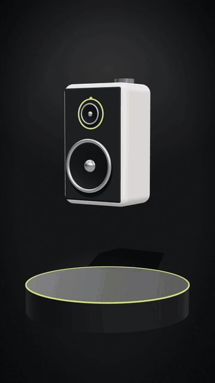
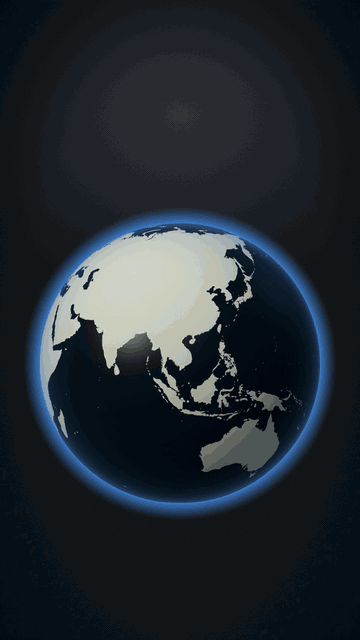
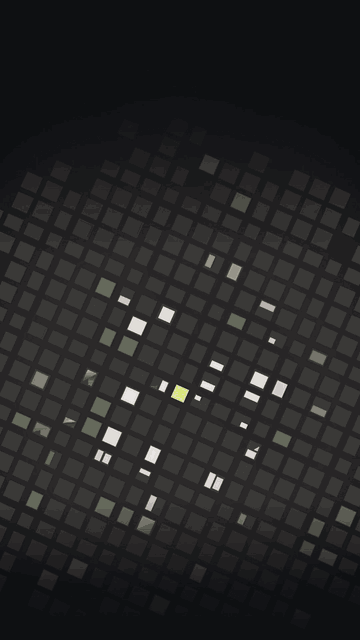
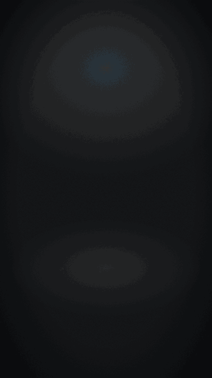
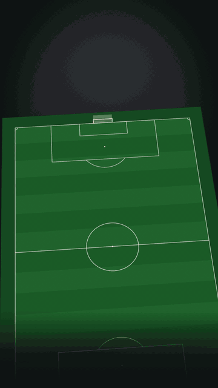
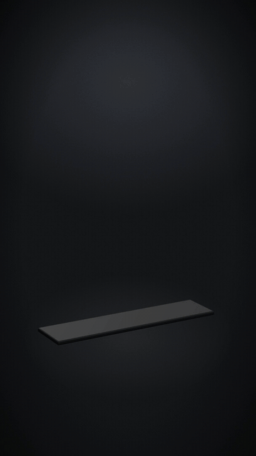
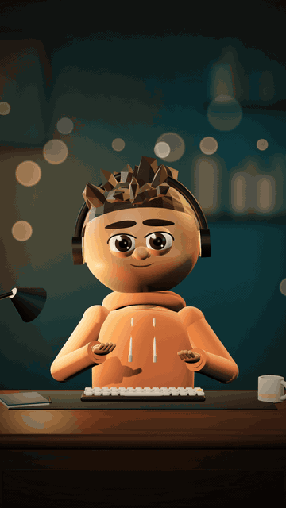

# Templates

Small, seekable HyperFrames scenes. Each folder has `index.html` (the scene), `params.json` (what you can change) and `preview.gif`.

Scaffold one into your project:

```bash
engines/hyperframes/scripts/new-scene.sh my-scene --template <name> --params values.json
```

<table>
<tr><td align="center" valign="top" width="25%"><br><b><code>kinetic-title</code></b><br><sub>One to three lines that build word by word (blur-rise with a small overshoot); one accent word in the italic serif and accent colour; optional underline sweep and exit.</sub></td><td align="center" valign="top" width="25%"><br><b><code>word-captions</code></b><br><sub>Short caption chunks that follow the voiceover; the word being spoken is in the accent colour, spoken words turn white, upcoming words are dimmed. A new chunk starts at a pause, a sentence end or maxWords.</sub></td><td align="center" valign="top" width="25%"><br><b><code>stat-counter</code></b><br><sub>One big number that counts up with a progress ring, a label and an on-screen source line. Every number needs a real, named source.</sub></td><td align="center" valign="top" width="25%"><br><b><code>phone-ui</code></b><br><sub>A phone that rises in and shows an app screen: a real screenshot (scrolls gently) or a simple list built from params, followed by a tap on one item.</sub></td></tr>
<tr><td align="center" valign="top" width="25%"><br><b><code>chat-thread</code></b><br><sub>A generic messaging conversation that builds message by message, with a typing indicator before each incoming message; older messages move up as new ones arrive.</sub></td><td align="center" valign="top" width="25%"><br><b><code>browser-window</code></b><br><sub>A real screenshot inside a browser frame: rises in with a slight tilt, scrolls, then zooms to a highlighted region with an accent box and a callout.</sub></td><td align="center" valign="top" width="25%"><br><b><code>checklist-reveal</code></b><br><sub>A title, then items that slide in one by one and get a drawn check mark; times can follow the voiceover.</sub></td><td align="center" valign="top" width="25%"><br><b><code>cover-still</code></b><br><sub>A 1080x1920 cover with kicker, headline (accent word) and subline kept inside the 3:4 grid crop / safe band (y 240-1680), over the standard backdrop or a darkened photo. Includes a drafting guide.</sub></td></tr>
</table>

## 3D templates (three.js)

These add a three.js canvas driven by `hf-seek` under the HTML text (contract, budget and checks: [engines/hyperframes/three/README.md](../engines/hyperframes/three/README.md)). Install `three@0.170.0` once (`globe-arcs-3d` also needs `world-atlas@2.0.2` and `topojson-client@3.1.0`); `new-scene.sh` copies them into the scene.

<table>
<tr><td align="center" valign="top" width="25%"><br><b><code>product-turntable-3d</code></b><br><sub>A product on a lit pedestal: it lowers in with a quarter turn, the camera orbits slowly and spec callouts draw leader lines to points on the object. Built-in speaker or your own GLB.</sub></td><td align="center" valign="top" width="25%"><br><b><code>globe-arcs-3d</code></b><br><sub>A lit Earth (Natural Earth land via world-atlas, dark ocean, atmosphere rim) turns to a region, pins drop on cities and great-circle arcs draw between them.</sub></td><td align="center" valign="top" width="25%"><br><b><code>city-pin-3d</code></b><br><sub>A seeded low-poly city: top-down to angled view, a pin drops on a highlighted building, walking-radius rings expand, amenity labels with minutes appear.</sub></td><td align="center" valign="top" width="25%"><br><b><code>house-build-3d</code></b><br><sub>A modern two-storey house assembles (slab, walls, windows, roofs land), the camera orbits and room labels count up their areas.</sub></td></tr>
<tr><td align="center" valign="top" width="25%"><br><b><code>pitch-tactics-3d</code></b><br><sub>A tilted pitch with regulation markings, numbered tokens in generic team colours, pass arrows with the ball following, dashed runs and a pressing zone.</sub></td><td align="center" valign="top" width="25%"><br><b><code>bars-3d</code></b><br><sub>4-7 columns rise with a stagger, values count up in labels that follow the bar tops, one bar in the accent colour, slow camera drift, source on screen.</sub></td></tr>
</table>

## Characters and avatars

Talking presenters for faceless and UGC videos (workflow: [skills/faceless-ugc](../skills/faceless-ugc/SKILL.md)). Mouth movement comes from the voice-over: `python3 tools/mouth_curve.py voice.mp3 -o scenes/<name>/mouth.json --fps 30`.

<table>
<tr><td align="center" valign="top" width="25%"><br><b><code>character-3d</code></b><br><sub>A stylised 3D presenter built from code at a desk in a warm, dim room: blinks, breathes, nods, switches expressions and gestures on cues, and talks from the voice-over curve. Five one-word presets; full frame or lower card.</sub></td><td align="center" valign="top" width="25%"><br><b><code>photo-avatar</code></b><br><sub>A cut-out photo or illustration as a talking 2.5D puppet: the jaw drops with the voice over an inner mouth, plus head sway, breathing and seeded blinks; full frame or a lower card with the head popping out.</sub></td><td></td><td></td></tr>
</table>
